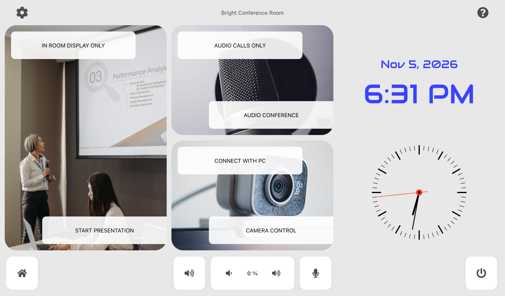
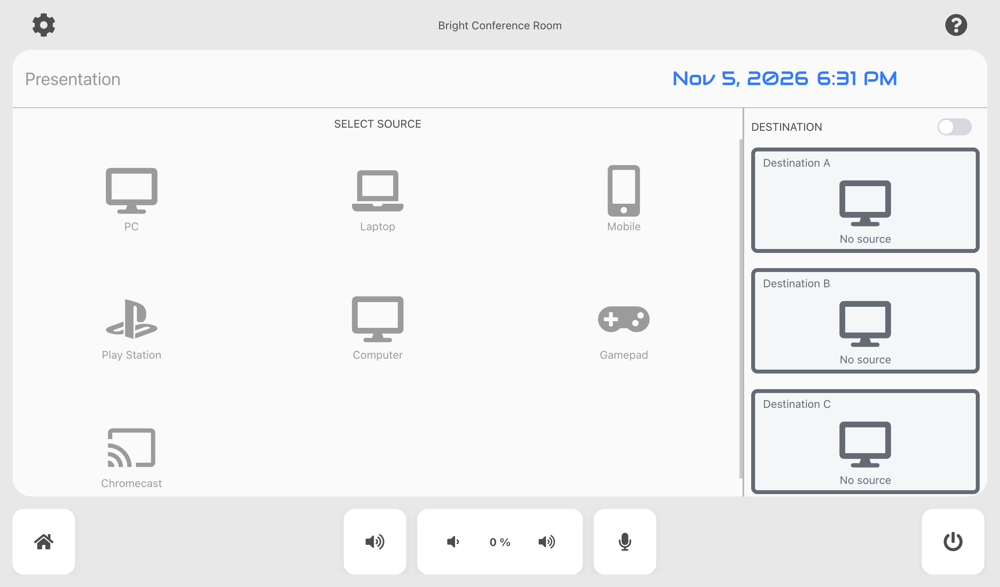
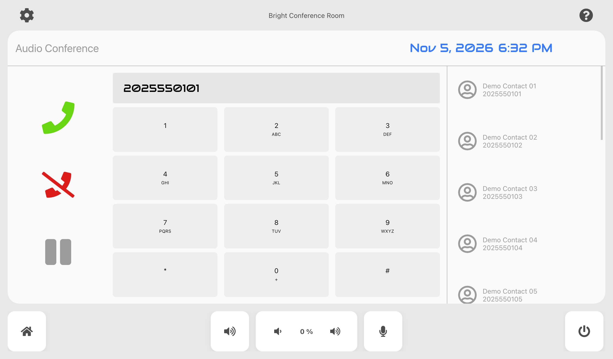
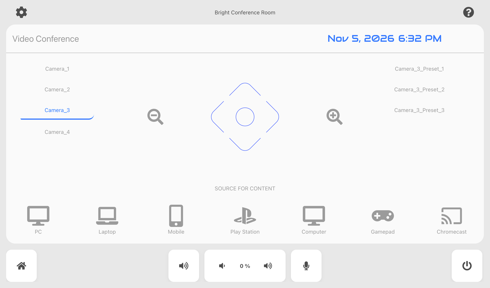
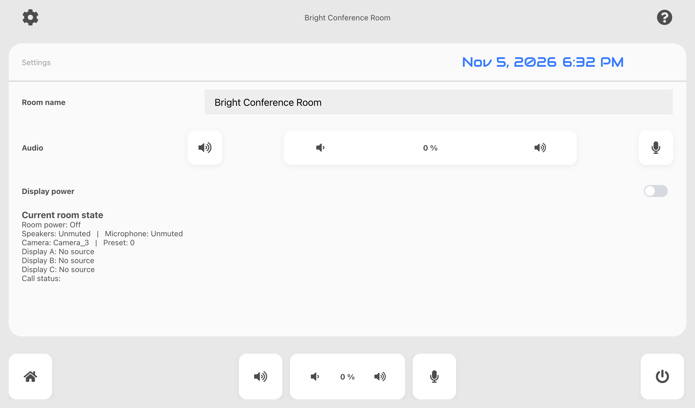

# Bright Conference Room — AVstudio NG Template

Template version: **0.1.0**. See [CHANGELOG.md](CHANGELOG.md).

A native AVstudio NG conference-room interface for presentation routing, audio calls,
camera/PTZ control, volume/mute, and session shutdown. Intended as a starting point for
commercial room installations with a separately programmed Crestron controller.

MIT covers AVstudio-Inc code, documentation and design. Third-party assets retain their
own licenses; see [third-party notices](THIRD_PARTY_NOTICES.md).

## Requirements and compatibility

- VS Code with the AVstudio editor extension, including its visual editors and `avstudio-live` debugger.
- Native project marker: [`AVstudio UI/avstudio.config`](AVstudio%20UI/avstudio.config).
  Open this repository folder in VS Code; the configured first screen is `pages/start.page`.
- This project declares **no minimum or pinned AVstudio NG version**. The exact editor
  version used for the preview was not established; no editor-version compatibility
  matrix has been verified. The 27.0.44 source snapshot cited in icon provenance is
  licensing evidence, not a compatibility claim.
- There is no `package.json`, dependency installation step, or npm development server.
  Node.js is not required to use this template.
- A Crestron processor and matching controller program are required for physical equipment
  operation. The processor program, AVstudio editor/runtime binaries, and device plugins
  are not distributed here. Their licensing and deployment requirements remain separate.

The UI uses native buttons, text, inputs, subpages, datasource lists, state controls,
date/time elements and D-pad controls, plus three JavaScript functions and a theme/CSS.
Local SVG icon sprites, JPEG backgrounds and font files are included; their rights status
is documented separately. No external custom-element bundles or video files were found.

## Download the template

### Download ZIP — no Git required

1. On this GitHub repository, choose **Code → Download ZIP**.
2. Extract the archive to a folder on your computer.
3. Open that folder in VS Code. It must contain `AVstudio UI/` and this README.

### Create your own repository

1. Choose **Use this template → Create a new repository**.
2. Select the owner, name and visibility for your repository, then create it.
3. Download your repository using **Code → Download ZIP** and extract it.
   Alternatively, if Git is installed, use **Git: Clone** in VS Code with your
   repository's HTTPS URL, then open the cloned folder.

Both options provide the native project files. Install the editor and configure your
connection using the steps below.

## Install the editor

1. Install [Visual Studio Code](https://code.visualstudio.com/) if needed.
2. Open Extensions (`Cmd+Shift+X` on macOS / `Ctrl+Shift+X` on Windows/Linux).
   Search for `@id:AVstudio.avstudio-editor` and install **AVstudio Editor** by AVstudio.
   The [official Marketplace listing](https://marketplace.visualstudio.com/items?itemName=AVstudio.avstudio-editor)
   currently specifies VS Code 1.104 or newer; check that listing for current requirements.
3. Reload VS Code if prompted. Use **File → Open Folder** to open the downloaded or
   cloned repository root, containing `AVstudio UI/`, rather than an individual page.
4. Open `AVstudio UI/pages/start.page` in the visual editor. If the extension requests
   account or license setup, complete it through **AVstudio Profile**; the template's
   MIT license does not provide an AVstudio product license.

## Open and configure

1. Open the repository folder in VS Code and inspect `AVstudio UI/avstudio.config`.
   Preserve the native `AVstudio UI/` layout and relative resource paths.
2. Copy `AVstudio UI/env/template.example.env` to `AVstudio UI/env/local.env`.
   Replace the neutral host and fill in the IP ID, room ID and WebSocket token required
   by your deployment. The example is intentionally not a working processor connection.
3. Select your local environment using the AVstudio **env** status-bar control.
   The connector uses documented `@env:KEY@` fields. No environment is selected by this
   repository; select one for preview and the appropriate environment when building.
   Never commit a real token, address book or environment file. Generated builds may
   contain resolved credentials and are excluded from Git.
4. Keep the connector filename `connectors/AVstudio LAB.crestron`, or update every binding
   and action that references it. The filename contains no live connection data.
5. Implement and verify [the Crestron join contract](docs/CRESTRON-JOIN-MAP.md) in your controller.
6. Launch preview through **F5 → Start AVS Live Preview**, using the included launch configuration.
   This is an editor workflow, not a terminal command. The template was visually
   reviewed in a local Chrome preview on 2026-11-05; see the screenshots below.

## Behavior and checks

- **Presentation:** select one or more destinations, then a source. A and C are initially
  selected locally. D101–103 transmit selection states; A100 requests a source. The
  controller must initialize/confirm selection, perform routing and return A111–113.
- `functions/presentation/routeSource.js` is **demonstration-only**: it previews local
  display labels/icons and sends no joins. It does not implement equipment switching.
  Incoming feedback is authoritative. A highlighted card alone does not confirm routing.
- **Audio calls:** a contact fills the number field. Dial sends the complete S201 number
  followed by D212; hangup sends D213 and clears the field; hold sends D214. The controller
  handles validation, duplicate requests and actual call state.
- **Video:** camera/preset selection uses A151/A152; PTZ and zoom use D51–57.
- **Volume/mute:** volume percentage and mute indications require processor feedback.
- **Shutdown:** the footer power button opens a cancellable 10-second countdown.
  End session or expiry sends D307. Test this only against an agreed safe controller setup.
- **Settings:** room name is session-local and resets on reload; audio/power controls use
  the same joins as the main UI. Help contains operating instructions.

Use AVstudio diagnostics, an editor build and the join-map acceptance checks before deployment.
The template passed file/reference checks. Automated test files are not included in
this distribution. Home, Presentation, Audio, Video and Settings were opened in the local
Chrome preview and their captures reviewed; contact selection was observed filling the
number field. A final local pass also checked multi-display source assignments, camera/
preset state in Settings and opening/canceling the shutdown countdown.
The owner confirms that the template was connected to a real Crestron processor and
that a deployment build was generated. The build archive is excluded from this source
repository. This does not establish acceptance of every function or compatibility with
every listed target device. During disconnected preview, the neutral example host produces
expected connection timeouts; contract-file and VS Code API warnings were also observed.
License/notice inclusion in deployment archives has not been inspected in this review.

## Other control systems and protocols

AVstudio Editor also provides connector types for HTTP/web requests, WebSocket, MQTT,
AMX, KNX and DoorBird, alongside Crestron. The broader platform ecosystem also includes
KNX BAOS, Node-RED, NETIO, Autonomic and RTSP video workflows. These can be used to adapt the interface to
other controllers, automation systems and network services, including 2N devices
with a suitable HTTP API. Available functions depend on the device model, firmware
and API licensing.

Additional platform workflows include **SIP/VoIP intercom**, **UDP** and
**VISCA over UDP** for compatible PTZ cameras. SIP uses the native intercom capability
of a supported AVstudio runtime, such as App Container. UDP-based control requires
an appropriate runtime or network bridge; ordinary browser hosting alone does not
provide raw UDP sockets. Camera commands must match the model's VISCA implementation.
See the [platform integration overview](https://avstudio.app/faq/) and
[Intercom / SIP API](https://docs.avstudio.app/app-container/intercom-sip-api/).

This template implements a Crestron join contract. Other integrations require configuring
the appropriate connectors and adapting actions, variables and feedback to the target
system's API or protocol. They are not preconfigured or tested in this template.
See the [AVstudio documentation](https://docs.avstudio.app/) for connector capabilities
and platform requirements.

## Deployment targets

Build the project for the runtime or touch panel used in your installation:

- **AVstudio AVS-10 and AVS-15** touch panels.
- **AVstudio App Container** and **AVstudio Control**, using the project import format
  supported by the installed application version.
- **Static web hosting**, serving the extracted HTML5 ZIP export over HTTP/HTTPS.
  The browser must support the required runtime APIs and be able to reach the controller.
  Configure HTTPS/WSS, certificates and cross-origin access as required by the deployment;
  a web server hosts the UI but does not replace the controller program.
- **Crestron ONE**, using its supported custom HTML5 project workflow.
- **Crestron HTML5-capable touch panels**, including TS/TSW-1070, TST-1080 and TS-1080,
  plus other models supporting custom HTML5 projects and the required runtime APIs.
  Use a CH5Z deployment package where required by the panel.

Select the export format for your target; a single archive format is not assumed to work
on every runtime. Check application/firmware requirements, connection settings and layout
on the actual device. This template has been reviewed in a desktop preview; the listed
targets are deployment options, not a device compatibility test matrix.

Platform references: [AVS panels](https://avstudio.app/products/avs-touch-panel/),
[App Container](https://avstudio.app/products/app-container/),
[Crestron HTML5 system requirements](https://sdkcon78221.crestron.com/sdk/Crestron_HTML5UI/Content/Topics/QS-System-Requirements.htm),
and [TS-1080 HTML5 support](https://docs.crestron.com/en-us/9577/Content/Topics/Features/TS/TS-1080-Features.htm).

## Build a deployment archive

1. Configure the connection and preview the main functions as described above.
2. Open the Command Palette (`Cmd+Shift+P` / `Ctrl+Shift+P`) and run
   **Run Project Health Check**. Review AVStudio entries in the Problems panel.
3. Check `AVstudio UI/avstudio.config`. This template currently sets
   `archiveName` to `bright-conference-room` and `archiveType` to `.ch5z`.
   Choose the archive format appropriate to your target in the editor configuration.
4. Run **Build project** from the Command Palette or the bottom status bar.
   If prompted for an environment, choose the intended deployment environment.
   The build replaces previous output in `AVstudio UI/build/`; copy any archive you
   need to retain elsewhere before building again.
5. For the supplied CH5Z configuration, find
   `AVstudio UI/build/bright-conference-room.ch5z`. The archive contains build metadata
   in `avstudio-meta.md`, including the extension version and build date.
   CH5Z is a Crestron package with an inner CH5 archive; deploy it using the workflow
   required by your target device. A ZIP export is an alternative HTML5 distribution.
6. Before distributing a deployment build, check that the required third-party credits
   and license texts accompany it, and complete the join-map hardware acceptance checks.
   Resolved connection credentials may be embedded in builds: keep deployment archives
   out of the public repository.

Build through the editor; no terminal compilation or npm installation is required.

## Screenshots

Local preview captures, 2026-11-05. Viewport: 1280 × 752 CSS pixels; PNGs:
2560 × 1504 pixels at 2× device pixel ratio. No mockups or edited UI states are used.
The Audio capture contains a demonstration contact number; it does not show an active call.
Presentation and camera photo sources/licenses are identified in THIRD_PARTY_NOTICES.md.
Microphone photography is credited to Pexels photo 194985. See docs/ICON-PROVENANCE.md
for icon sources. Screenshots retain the underlying asset licenses.



| Presentation                                                                       | Audio                                                                  |
| ---------------------------------------------------------------------------------- | ---------------------------------------------------------------------- |
|  |  |

| Video                                                        | Settings                                                          |
| ------------------------------------------------------------ | ----------------------------------------------------------------- |
|  |  |

At 1280 × 752, all seven presentation sources and all three destination cards are visible.
These captures document the interface, not verified operation of connected equipment.

## Customize for your room

Change room name/defaults, camera and preset labels, source IDs and icons, contact data,
timezone/date format, theme and activity backgrounds. Preserve explicit source `joinValue`
assignments unless the controller contract changes with them. Replace all demonstration
contacts before use. Verify your rights to every replacement asset.

## Structure

```text
AVstudio UI/
  avstudio.config          Native project marker, start page, theme and export settings
  global.variables         State and Crestron feedback bindings
  global.slots             Shared header/footer
  pages/                   Start, Help, Settings, presentation/, audio/, video/, components/
  functions/               crestron/syncFeedback.js, presentation/routeSource.js,
                           system/shutdownCountdown.js
  connectors/              Environment-backed Crestron configuration
  env/                     Public example; real local environments are ignored
  datasources/             Sources and demonstration contacts
  assets/                  Local SVG sprites and JPEG backgrounds
  theme/                   Native theme, CSS and fonts
.vscode/launch.json         AVstudio preview debug configuration
docs/CRESTRON-JOIN-MAP.md   Controller integration contract
AGENTS.md                  Project-specific AI editing rules
```

## Limits, distribution and licensing

There is no controller source code in this template. Contact data is demonstration data;
local selections are optimistic; the room name is not persisted. Resolved deployment builds
must not be published with real credentials. macOS was used for file checks; Windows/Linux
and target Crestron panels have not been verified.

The repository is about 7 MiB including documentation and screenshots; its
largest file is about 1.7 MiB. No Git LFS is needed. GitHub warns above 50 MiB and blocks files above 100 MiB;
[template repositories cannot contain files stored with Git LFS](https://docs.github.com/en/repositories/creating-and-managing-repositories/creating-a-template-repository).
Keep future large optional media outside the template, for example as separately licensed
release downloads, and explain any extra setup explicitly.

Code, documentation and design owned by AVstudio-Inc are licensed under the
[MIT License](LICENSE). The owner confirmed ownership or permission to redistribute this
first-party material. Third-party materials are excluded from this MIT grant and retain
their own terms; see [THIRD_PARTY_NOTICES.md](THIRD_PARTY_NOTICES.md).
Font binaries are unchanged and remain under SIL OFL 1.1; the full text and notices are
included in `AVstudio UI/theme/licenses/`. The presentation photo is credited to Pavel Danilyuk (Pexels), and the camera photo
to Emiliano Cicero (Unsplash), under their respective licenses. The microphone photo
is credited to revac film's&photography (Pexels). Icon provenance is verified: Font Awesome SVGs retain CC BY 4.0 and Ant Design Icons
retains its upstream MIT notice. Full texts and credits are included under
`AVstudio UI/assets/licenses/icons/`; verify their inclusion in the final production archive.
